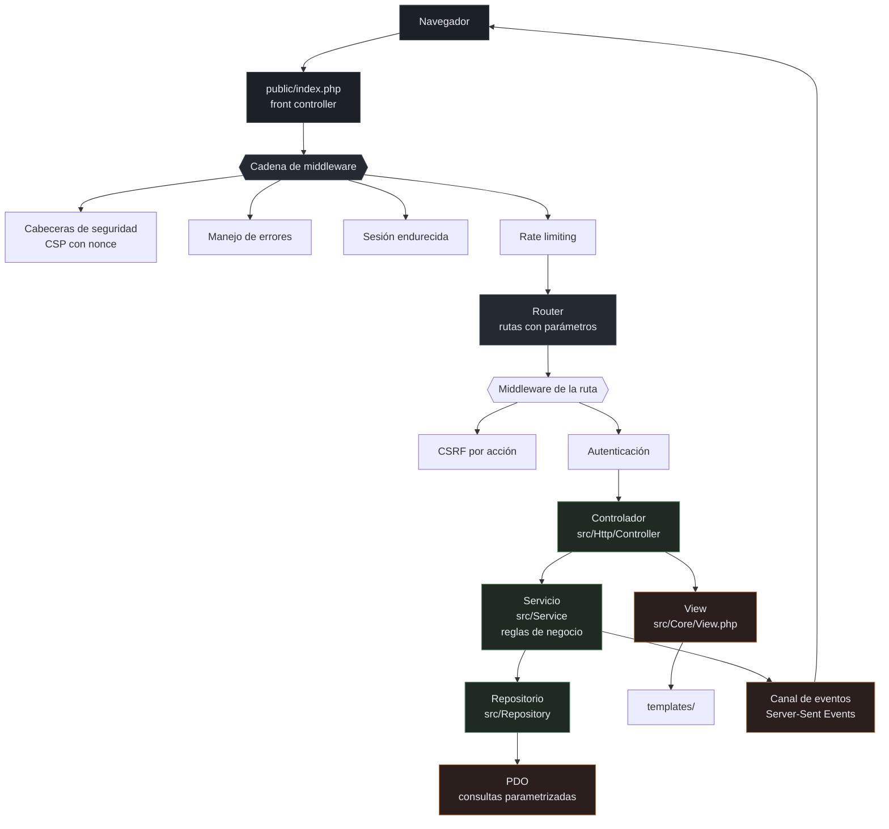

# DataForge

**Consola web multiusuario para MySQL: crea bases de datos, diseña tablas y opera con registros desde el navegador.**

**DataForge is a multi-user web console for MySQL: create databases, design tables and work with records from the browser.**
**Each account only reaches the databases it owns, and every change is written to an audit log.**
**Plain PHP 8.5 with PDO, MySQL 8.4, PHPUnit, PHPStan and Docker Compose: no framework, no ORM.**

---

## Características verificadas

Cada punto de esta lista corresponde a código del repositorio.

| Funcionalidad | Dónde está |
|---|---|
| Cuentas de usuario con registro, acceso, cambio de contrasena y baja | `src/Service/AuthService.php` |
| **Aislamiento entre cuentas**: cada base de datos tiene un propietario | `src/Repository/ManagedDatabaseRepository.php` |
| Alta y baja de bases de datos MySQL | `src/Service/DatabaseService.php` |
| Constructor de tablas con 11 tipos de dato y columna `id` automática | `src/Service/TableService.php`, `src/Database/ColumnType.php` |
| Edición de estructura: añadir, cambiar tipo y eliminar columnas | `src/Service/TableService.php` |
| CRUD de registros con formularios generados desde el esquema real | `src/Service/RecordService.php` |
| Listado con paginación, orden por columna y búsqueda en todas las columnas | `src/Service/RecordService.php` |
| Consola SQL de **solo lectura** con límite de filas y tiempo de ejecución | `src/Service/QueryService.php`, `src/Service/SqlGuard.php` |
| **Tiempo real**: el panel se actualiza con Server-Sent Events, sin recargar | `src/Http/Controller/EventController.php`, `src/Service/LiveFeed.php` |
| Exportación de una tabla en CSV y de una base de datos en `.sql` | `src/Service/ExportService.php` |
| Bitácora de auditoría por usuario | `src/Repository/ActivityRepository.php` |
| Siete paletas de color y modo claro/oscuro | `src/Support/Theme.php`, `public/assets/css/themes.css` |
| Migraciones de esquema versionadas | `database/migrations/`, `src/Database/Migrator.php` |
| Consola de administración (`migrate`, `routes`, `version`) | `bin/console` |

---

## Arquitectura



El detalle de cada decisión está en [docs/ARCHITECTURE.md](docs/ARCHITECTURE.md).

---

## Stack

| Capa | Tecnología |
|---|---|
| Lenguaje | PHP 8.5 (`declare(strict_types=1)` en todo el código) |
| Base de datos | MySQL 8.4 LTS sobre PDO con consultas parametrizadas reales |
| Frontend | HTML5, CSS3 y JavaScript sin dependencias ni CDN |
| Tiempo real | Server-Sent Events sobre HTTP nativo |
| Contenedores | Docker Compose: PHP + Apache, MySQL, phpMyAdmin, Redis |
| Pruebas | PHPUnit 13 (unitarias y de integración) |
| Estáticos | PHPStan nivel 8 y PHP-CS-Fixer (PSR-12) |
| CI | GitHub Actions: estilo, escape, análisis, pruebas e higiene del repo |

---

## Instalación

### Con Docker

```bash
git clone https://github.com/JuanCarlosBarronLopez/DataForge.git
cd DataForge
cp .env.example .env
docker compose up -d --build
```

| Servicio | URL |
|---|---|
| Aplicación | http://localhost:8080 |
| phpMyAdmin | http://localhost:8081 |
| MySQL (puerto del host) | `localhost:3307` |

El contenedor aplica las migraciones al arrancar. Para hacerlo a mano:

```bash
docker compose exec app php bin/console migrate
```

> El usuario de MySQL necesita privilegios administrativos sobre el servidor: el producto
> consiste precisamente en crear y administrar bases de datos.
> `docker/mysql-init/01-privileges.sql` los concede la primera vez que se crea el volumen.
> Si el volumen ya existe, `docker compose down -v` lo recrea.

### Sin Docker

Requisitos: PHP 8.5 o superior con `pdo_mysql` y `gd`, y MySQL 8.4.

```bash
git clone https://github.com/JuanCarlosBarronLopez/DataForge.git
cd DataForge
composer install
cp .env.example .env      # ajusta DB_HOST, DB_USER, DB_PASS y SYSTEM_DB
php bin/console migrate
php -S localhost:8080 -t public
```

---

## Pruebas

```bash
composer install
composer check        # estilo + escape + análisis estático + pruebas
```

| Herramienta | Qué comprueba | Comando |
|---|---|---|
| PHPUnit 13 | 135 pruebas unitarias y de integración | `composer test` |
| PHPStan nivel 8 | Tipos, referencias y ramas no cubiertas | `composer analyse` |
| PHP-CS-Fixer | Norma PSR-12 y `strict_types` | `composer lint` |
| `check-escape` | Que ninguna plantilla imprima datos sin pasar por `e()` | `composer check:escape` |
| GitHub Actions | Las cuatro anteriores en cada push y en cada PR | `.github/workflows/ci.yml` |

Las pruebas de integración necesitan un MySQL accesible:

```bash
DB_HOST=127.0.0.1 DB_PORT=3306 \
DB_USER=root DB_PASS=root_secret \
DB_ADMIN_USER=root DB_ADMIN_PASS=root_secret \
SYSTEM_DB=dataforge_test \
vendor/bin/phpunit
```

`DB_ADMIN_USER` y `DB_ADMIN_PASS` son los permisos con los que las pruebas crean y borran sus
propias bases de datos. Sin MySQL, la suite se omite en lugar de fallar.

Para levantar el entorno de herramientas sin PHP en el equipo:

```bash
docker build -t dataforge-dev -f docker/dev.Dockerfile docker
docker run --rm -v "$(pwd)":/app -w /app dataforge-dev composer check
```

---

## Docker

`docker-compose.yml` levanta cuatro servicios:

| Servicio | Imagen | Puerto | Función |
|---|---|---|---|
| `app` | `php:8.5-apache` | `8080` | Aplicación con el front controller en `public/` |
| `db` | `mysql:8.4` | `3307` | MySQL 8.4 LTS con volumen persistente |
| `phpmyadmin` | `phpmyadmin/phpmyadmin` | `8081` | Administración visual del servidor |
| `redis` | `redis:8-alpine` | `6380` | Backend del rate limiting (opcional) |

Detalles del contenedor:

- `Dockerfile` de producción en dos etapas: las dependencias se instalan con `composer install
  --no-dev --optimize-autoloader` y el código se copia después.
- `docker/entrypoint.sh` ajusta el puerto de Apache al de la plataforma, prepara los directorios
  de trabajo y aplica las migraciones con reintentos.
- `docker/apache.conf` deja `public/` como único directorio accesible y desactiva el motor PHP
  en el directorio de archivos subidos.
- `docker/php-production.ini` activa opcache, desactiva la muestra de errores y fija los
  parámetros de sesión.
- `docker/mysql-init/01-privileges.sql` concede los permisos que la aplicación necesita.

---

## Decisiones de diseño

**Sin framework.** El valor de un proyecto está en los mecanismos, no en aprender una API. Un
framework habría cambiado la pregunta de "cómo funciona esto" por "cómo se configura esto". El
coste es escribir a mano el enrutador, el contenedor, las plantillas y el manejo de errores, y
que todo eso tenga que estar cubierto por pruebas.

**Front controller y directorio único.** Todo el tráfico entra por `public/index.php` y Apache sirve
`public/` como `DocumentRoot`. Es la única forma de que `src/`, `config/` y `storage/` no sean
descargables por error: si el directorio publicado es la raíz del proyecto, la seguridad depende
de acertar con los `.htaccess`.

**Identificadores con lista blanca, no con escape.** PDO no admite marcadores para nombres de
objeto, así que los nombres de base, tabla y columna tienen que interpolarse. Escaparlos con
`real_escape_string()` no sirve: no escapa el acento grave, de modo que un nombre de tabla puede
cerrar el identificador y continuar la sentencia. Por eso todo identificador pasa por
`DataForge\Support\Identifier`, que solo admite `[A-Za-z0-9_]{1,64}`.

**Consultas parametrizadas de verdad.** PDO con `ATTR_EMULATE_PREPARES => false`: los marcadores
los resuelve el servidor, no PHP.

**Aislamiento entre cuentas.** Cada base de datos tiene un propietario registrado y toda operación
comprueba esa propiedad. Es la diferencia entre "varias cuentas pueden entrar" y "cada cuenta ve
lo suyo".

**Consola SQL de solo lectura.** Una consola que ejecuta lo que se le escriba convierte cualquier
fallo de autorización en escritura arbitraria. `SqlGuard` acepta un único enunciado de lectura,
aplica un límite de filas y fija un tiempo de ejecución máximo.

**Escape de la salida exigible.** El escape puede quedar en manos de quien escribe la vista.
`bin/check-escape.php` revisa las 200 expresiones de las plantillas y falla la integración
continua si alguna imprime un dato sin pasar por `e()`. Es una afirmación que se puede comprobar,
no una promesa.

**Tiempo real con Server-Sent Events.** El panel muestra métricas que dependen de MySQL: contar
filas de todas las tablas en cada recarga es caro y el usuario ve números obsoletos. SSE es la
solución más simple que no necesita librerías de cliente ni un servidor de eventos aparte: es
HTTP nativo con `text/event-stream`.

---

## Estado del proyecto

Verificado sobre la rama actual: **135 pruebas en verde**, PHPStan nivel 8 sin avisos, PHP-CS-Fixer
sin cambios pendientes, Lighthouse 100 en accesibilidad, buenas prácticas y SEO, y el recorrido
completo de la interfaz comprobado en navegador sin errores de consola.

**En producción hoy:**

- Cuentas de usuario con aislamiento de bases de datos por propietario.
- Ciclo completo de gestión: bases, tablas, estructura, registros y bitácora.
- Consola SQL de solo lectura con historial.
- Panel en vivo por Server-Sent Events.
- Exportación CSV y volcado SQL.
- Siete paletas y modo claro/oscuro.
- Migraciones versionadas, CI con cuatro comprobaciones y despliegue con Docker Compose.

**Pendiente, con el tamaño del trabajo estimado:**

| Tarea | Por qué está pendiente |
|---|---|
| Verificación de correo y restablecimiento de contraseña | Requiere un proveedor de correo que no forma parte del proyecto |
| API REST | El enrutador y los servicios ya están preparados; falta la superficie HTTP y sus tokens |
| Sesiones compartidas entre instancias | Hoy viven en archivos: con más de una instancia habría que migrarlas a Redis |
| Escalado del canal de eventos | Cada conexión ocupa un proceso de PHP: con muchas simultáneas habría que pasar a un servidor de eventos |
| Cola de trabajos | Las exportaciones grandes se generan de forma síncrona |
| Copia de seguridad automatizada | `storage/` y las bases del usuario dependen hoy del operador |
| Nombres de base de datos por usuario | MySQL tiene un espacio de nombres global: dos usuarios no pueden usar el mismo nombre |
| Búsqueda con acentos y mayúsculas | La búsqueda usa el `collation` por defecto de MySQL |
| Renombrar una base de datos | La interfaz solo permite crearlas y eliminarlas |

Detalle del modelo de amenazas, de lo que sí está implementado y de lo que falta, en
[SECURITY.md](SECURITY.md).

---

## Documentación adicional

- [docs/ARCHITECTURE.md](docs/ARCHITECTURE.md): arquitectura y decisiones con su porqué
- [SECURITY.md](SECURITY.md): modelo de amenazas y medidas implementadas
- [CONTRIBUTING.md](CONTRIBUTING.md): cómo ejecutar y probar el proyecto
- [CHANGELOG.md](CHANGELOG.md): cambios por versión

---

## Licencia

MIT. Ver [LICENSE](LICENSE). Proyecto de OMNARA.
